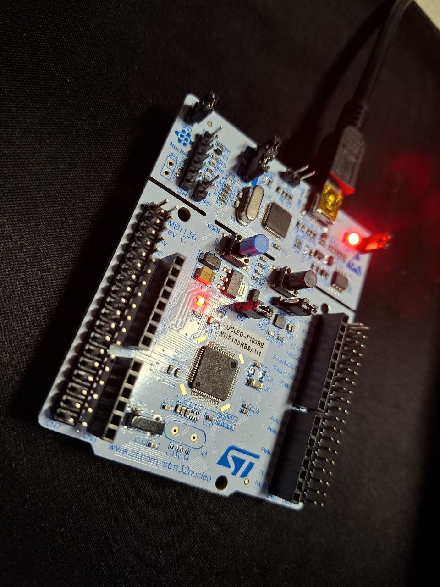

# stm32-baremetal-driver

<p align="center">
  
</p>

Register-level drivers and a demo application for the **STM32F103RB** (Cortex-M3), written in C without HAL or any vendor middleware. Only the CMSIS headers are used.

The firmware brings the MCU up to 72 MHz, starts a 1 ms system tick, and runs a small UART command interface that controls an LED. Every peripheral lives in its own module with a small public API; interrupt handlers sit next to the peripheral they belong to.

## Features

- **Clock** – HSE (8 MHz) → PLL ×9 → 72 MHz SYSCLK, APB1 = 36 MHz, with timeouts and error codes
- **SysTick** – 1 ms time base, `millis()` and wrap-safe `delay_ms()`
- **GPIO** – pin configuration (CRL/CRH), atomic write/toggle via `BSRR`, read
- **USART2** – 115200 8N1, baud rate computed from the real APB1 clock, interrupt-driven RX
- **Ring buffer** – lock-free single-producer/single-consumer buffer between the USART ISR and `main`
- **LED** – thin module on top of GPIO
- Builds with CMake and `arm-none-eabi-gcc`, flashes with OpenOCD, no IDE required

## Hardware

| Item | Value |
|------|-------|
| MCU | STM32F103RBT6 (128 KB Flash, 20 KB RAM) |
| Board | Nucleo-F103RB |
| Clock source | 8 MHz HSE |
| LED | PA5 |
| UART | USART2, TX = PA2, RX = PA3 (ST-LINK virtual COM port on Nucleo) |
| Debug/flash | SWD via ST-LINK |

## Project structure

```
.
├── CMakeLists.txt
├── flash.cfg                  # OpenOCD interface + target configuration
├── CMSIS/                     # CMSIS Core and STM32F1xx device headers
├── linker/
│   └── STM32F103RBTx_FLASH.ld
├── startup/
│   └── startup_stm32f103xb.s
└── src/
    ├── main.c                 # init sequence and main loop
    ├── system_stm32f1xx.c
    └── peripherals/
        ├── clock/             # clock_init()
        ├── gpio/              # gpio_configure(), gpio_write(), ...
        ├── led/               # led_init(), led_on(), ...
        ├── ring_buffer/       # rb_push(), rb_pop()
        ├── systick/           # systick_init(), millis(), delay_ms()
        └── usart/             # usart_init(), usart_read_byte(), ...
```

## Modules

| Module | Responsibility | Depends on |
|--------|----------------|------------|
| `clock` | Configure the system clock tree | CMSIS |
| `systick` | 1 ms tick, time since start | CMSIS |
| `gpio` | Generic pin configuration and access | CMSIS |
| `led` | Board LED | `gpio` |
| `ring_buffer` | Byte FIFO, ISR-safe for one producer and one consumer | – |
| `usart` | Serial communication | `gpio`, `ring_buffer` |

Interrupt handlers (`SysTick_Handler`, `USART2_IRQHandler`) are defined in the module that owns the peripheral. Their names must match the vector table in `startup_stm32f103xb.s`.

## Prerequisites

| Tool | Version | Purpose |
|------|---------|---------|
| [Arm GNU Toolchain](https://developer.arm.com/downloads/-/arm-gnu-toolchain-downloads) (`arm-none-eabi-gcc`) | 12 or newer | Compiler, linker, `objcopy`, `size` |
| [CMake](https://cmake.org/download/) | 3.22 or newer | Build system generator |
| GNU Make for Windows (`mingw32-make`, from [MinGW-w64](https://www.mingw-w64.org/) or [MSYS2](https://www.msys2.org/)) | any recent | Build tool |
| [OpenOCD](https://openocd.org/) | 0.11 or newer | Flashing and debugging |
| Serial terminal (PuTTY, Tera Term, `picocom`) | – | Talking to the board |

All tools must be available in `PATH`. Check:

```
arm-none-eabi-gcc --version
cmake --version
mingw32-make --version
openocd --version
```

The project is developed and built on Windows with the **MinGW Makefiles** CMake generator. On Linux or macOS use `-G "Unix Makefiles"` (or `-G Ninja`) instead; nothing else changes.

## Build

Run in PowerShell or cmd:

```
git clone https://github.com/<your-username>/stm32-baremetal-driver.git
cd stm32-baremetal-driver

cmake -S . -B build -G "MinGW Makefiles"
cmake --build build
```

<<<<<<< HEAD
=======
With GNU Make instead of Ninja use `-G "MinGW Makefiles"`.

>>>>>>> ea132693f10ce1df5309a4ec31e55b630f0a25f5
Build type is `Debug` (`-Og -g3`) by default. For an optimized build:

```
cmake -S . -B build-release -G "MinGW Makefiles" -DCMAKE_BUILD_TYPE=Release
cmake --build build-release
```

After a successful build, `build/` contains:

| File | Description |
|------|-------------|
| `stm32-baremetal-driver.elf` | Executable with debug symbols (used for flashing and debugging) |
| `stm32-baremetal-driver.hex` | Intel HEX image |
| `stm32-baremetal-driver.bin` | Raw binary image |
| `stm32-baremetal-driver.map` | Linker map |

The linker prints Flash and RAM usage at the end of the build.

To start from scratch, delete the `build/` directory and configure again.

## Flash

Connect the board over USB (ST-LINK), then:

```
cmake --build build --target flash
```

This runs OpenOCD with `flash.cfg`, programs the ELF file, verifies it and resets the MCU. Equivalent manual command:

```
openocd -f flash.cfg -c "program build/stm32-baremetal-driver.elf verify reset exit"
```

`flash.cfg` is expected to select only the debug interface and the target, for example:

```
source [find interface/stlink.cfg]
source [find target/stm32f1x.cfg]
```

## Debug

Start the OpenOCD GDB server:

```
openocd -f flash.cfg
```

In another terminal:

```
arm-none-eabi-gdb build/stm32-baremetal-driver.elf
(gdb) target extended-remote :3333
(gdb) monitor reset halt
(gdb) load
(gdb) continue
```

In VS Code the same setup works with the Cortex-Debug extension and the `launch.json` from `.vscode/`.

## Usage

Open the board's serial port at **115200 baud, 8N1, no flow control**. On Nucleo it appears as the "STMicroelectronics STLink Virtual COM Port".

Every 4 seconds the firmware prints the core clock:

```
Core Clock: 72000000 Hz
```

Send a single character to control the LED on PA5. The firmware echoes every received character back.

| Character | Action |
|-----------|--------|
| `1` | LED on |
| `0` | LED off |
| `t` | Toggle LED |

If the clock fails to start (for example, no HSE), the firmware stays in an error loop instead of continuing on the wrong clock.

## Design notes

- **No HAL.** All peripheral access goes through CMSIS register definitions, with `MODIFY_REG`, `SET_BIT` and `CLEAR_BIT` so unrelated bits are never touched by accident.
- **Atomic pin writes.** Output changes use `BSRR`, not read-modify-write on `ODR`.
- **ISR ↔ main communication** goes through a ring buffer with one writer per index, so no interrupts are disabled in the main loop.
- **UART errors** (overrun, framing, noise) are detected and flagged bytes are dropped.
- **Wrap-safe timing.** Time comparisons use unsigned subtraction: `(millis() - start) >= period`.
- **Derived values, not constants.** The USART baud rate divisor is computed from the actual bus clock, so changing the clock configuration does not silently break the serial speed.

## Troubleshooting

| Symptom | Likely cause |
|---------|--------------|
| `arm-none-eabi-gcc: command not found` | Toolchain is not in `PATH` |
| `CMake was unable to find a build program corresponding to "MinGW Makefiles"` | `mingw32-make` is not in `PATH` |
| Build uses wrong compiler or generator after changing settings | Stale cache: delete `build/` and run the configure step again |
| `undefined reference to ...` | Source file is not listed in `add_executable` in `CMakeLists.txt` |
| `fatal error: xyz.h: No such file` | Module directory is missing from `target_include_directories` |
| No output on the terminal | Wrong COM port or baud rate; check that the board was reset after flashing |
| Garbage on the terminal | Clock did not reach 72 MHz or baud rate mismatch |
| `Error: open failed` / `no device found` in OpenOCD | ST-LINK not connected, driver missing, or another program holds the debugger |
| LED never changes | Interrupts not firing: check that handler names match the vector table |

## Roadmap

- [ ] UART transmit over DMA
- [ ] Command parser instead of single-character commands
- [ ] Independent watchdog (IWDG)
- [ ] Host-side unit tests for the ring buffer
- [ ] CI: build and static analysis on every push

## License

MIT, see `LICENSE`.
